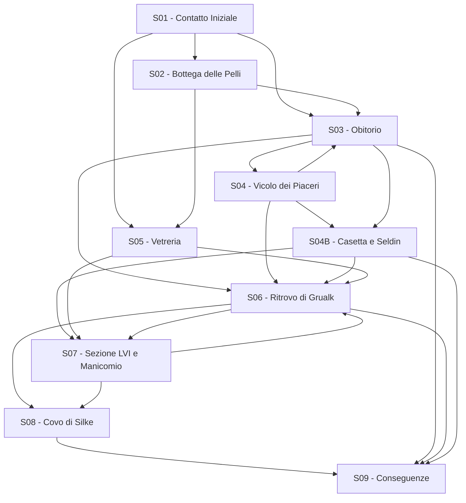

# La Morte Strisciante

## Riassunto

Una serie di omicidi apparentemente scollegati sconvolge i Bassifondi di [[Mendulia's Rock]]. Le vittime lavoravano tutte nel commercio di carni e pelli. Dietro gli omicidi si cela una cospirazione guidata dalla necromante [[Silke]], aiutata dall'ufficiale [[Zakara]] e da vari criminali locali.

## PNG Principali
- [[Procurator Alexis]]
- [[Zakara]]
- [[Silke]]
- [[Grualk]]

## Luoghi Principali
- [[Bottega delle Pelli]]
- [[Obitorio]]
- [[Vetreria]]
- [[Sezione LVI]]

## Storyline
- [[S01 - Contatto Iniziale]]
- [[S02 - Bottega delle Pelli]]
- [[S03 - Obitorio]]
- [[S04 - Vicolo dei Piaceri]]
- [[S04B - Casetta dei Nonni e Seldin]]
- [[S05 - Vetreria]]
- [[S06 - Ritrovo di Grualk]]
- [[S07 - Sezione LVI e Manicomio]]
- [[S08 - Covo di Silke]]
- [[S09 - Conseguenze]]

## Struttura investigativa

Le scene sono nodi disponibili, non tappe obbligatorie. [[S01 - Contatto Iniziale]] presenta il caso; da quel momento i personaggi scelgono la pista da seguire. Ogni nodo offre più prove e più uscite, così un fallimento o una visita saltata cambia il costo della soluzione senza bloccarla.

### Criteri per ogni nodo

- **Ingressi:** almeno due motivi narrativi per visitarlo.
- **Domanda:** che cosa i PG vogliono stabilire.
- **Prove essenziali:** ricavabili da almeno due fonti.
- **Uscite:** almeno due altri nodi o azioni possibili.
- **Pressione:** cosa peggiora se il gruppo tarda, attira attenzione o fallisce.
- **Conseguenza:** che cosa il nodo cambia anche se la visita è parziale.

### Accesso al finale

I PG possono raggiungere [[S08 - Covo di Silke]] combinando almeno due segnali:

- posizione o ingresso della Sezione LVI;
- testimonianza o prova del traffico di corpi;
- collegamento fra Grualk, Zakara e i rituali;
- indizio da Silke, Wonderrod o dalla vetreria.

La chiave LVI è utile ma non indispensabile. Se il gruppo non la ottiene, può usare una mappa, forzare la grata, seguire una consegna o ricevere assistenza da Esteran Tara.

### Prove indispensabili

Distribuire le prove nei nodi in modo che almeno tre percorsi indipendenti conducono a ogni conclusione:

| Conclusione | Fonti possibili |
| --- | --- |
| Esiste un traffico di salme | Bottega, Obitorio, Ritrovo, Covo |
| Grualk organizza le consegne | Obitorio, Vicolo, Vetreria, Ritrovo |
| Zakara insabbia l'indagine | Bottega, Obitorio, Vetreria, Ritrovo, Covo |
| Il traffico ha una destinazione sotterranea | Ritrovo, Vetreria, Manicomio, Covo |
| Silke dirige la rete | Ritrovo, Covo, confessione di Grualk |

Un solo oggetto può suggerire una conclusione, ma non deve custodire da solo l'unica informazione necessaria.

### Indizi ridondanti

Conservare sempre una pista principale e una pista di recupero per ogni conclusione. Se una prova fisica viene distrutta o perduta, non sostituirla con un muro narrativo: sposta l'indizio su una testimonianza, una coincidenza di date, un sigillo, una consegna o una scelta dell'antagonista.

| Prova perduta | Recuperi disponibili |
| --- | --- |
| Registro di Roardus | frammento della Bottega, inventario dell'Obitorio, copia nel Ritrovo, memoria di Grualk |
| Confessione di Claudius | registro dei movimenti, pagamenti del Vicolo, testimonianza degli addetti, ordini nel Ritrovo |
| Spilla della Vetreria | disegno di Tyril, residuo di vetro alla Bottega, segno sulle casse, pergamena nel Covo |
| Chiave LVI | mappa di Alexis, indicazioni di Grualk, accesso forzato, strada osservata dal manicomio |
| Diario di Silke | lettere di Zakara, pergamena del Legame, confessione, giara della Vetreria |

### Continuare dopo un fallimento

Un fallimento aggiunge un costo ma non rimuove le prove essenziali:

1. **Conseguenza concreta:** una prova viene spostata, un testimone fugge, un luogo entra in allarme o qualcuno resta ferito.
2. **Informazione garantita:** i PG mantengono un indizio sufficiente a sapere dove cercare.
3. **Nuova scelta:** offrono almeno due alternative, una rischiosa e immediata e una lenta ma più informata.
4. **Costo persistente:** se necessario avanza un clock o modifica l'atteggiamento di una fazione.

Una prova essenziale può venire corrotta o contestata, ma non cancellata senza lasciare una fonte alternativa già giocabile.

## I tre clock dell'avventura

Questi sono gli unici tre clock **globali**. I clock locali di una singola scena indicano allarme, preparazione o pazienza e non sostituiscono quelli narrativi.

| Clock | Misura | Si riempie quando | Effetto a completamento | Come arrestarlo o ridurlo |
| --- | --- | --- | --- | --- |
| **Panico nei Bassifondi — 6** | Perdita di fiducia della popolazione | nuovi omicidi, arresti ingiusti, violenza pubblica, prove ignorate | La milizia perde il controllo locale; informatori e luoghi diventano ostili | salvare testimoni, rendere pubbliche prove, proteggere famiglie e apprendisti |
| **Copertura di Zakara — 6** | Controllo dell'indagine da parte di Zakara | prove consegnate a lei, testimoni isolati, false versioni accettate | Zakara tenta arresto, espulsione o eliminazione politica dei PG | coinvolgere Alexis, conservare copie, ottenere fonti indipendenti, smascherare una contraddizione |
| **Esperimenti di Silke — 8** | Progresso del Legame Necromantico | consegne riuscite, cadaveri ottenuti, tempo concesso a Silke, rituale alimentato | Compare una nuova forza non morta o il finale inizia con il rituale quasi completo | distruggere materiali, liberare testimoni, sabotare il ritrovo o il laboratorio |

I settori dei clock **non avanzano contemporaneamente per automatismo**. Ogni evento influenza il fronte che rappresenta; un incendio al Ritrovo, per esempio, può colpire gli Esperimenti senza aumentare il Panico se resta occulto. Segnare anche eventuali riduzioni quando i PG ottengono successi significativi.

## S09 nell'avventura

[[S09 - Conseguenze]] non è una semplice chiusura. È il nodo che determina chi custodisce le prove, quale versione diventa pubblica e quale fronte rimane attivo. Giocarlo dopo la conclusione del Covo, ma anche dopo una cattura prematura o un'esposizione riuscita di Zakara.

## Epilogo
Dopo la sconfitta di [[Silke]] e la scoperta del tradimento di [[Zakara]], gli avventurieri ricevono la ricompensa promessa dal [[Procurator Alexis]].
Alexis, profondamente colpito dagli eventi, decide di ritirarsi dal servizio e lasciare [[Mendulia's Rock]].
Le prove recuperate nel covo della necromante rivelano inoltre possibili collegamenti tra [[Wonderrod]] e infiltrazioni necromantiche nei Bassifondi.
Questi eventi aprono la strada a nuove indagini e future storyline.