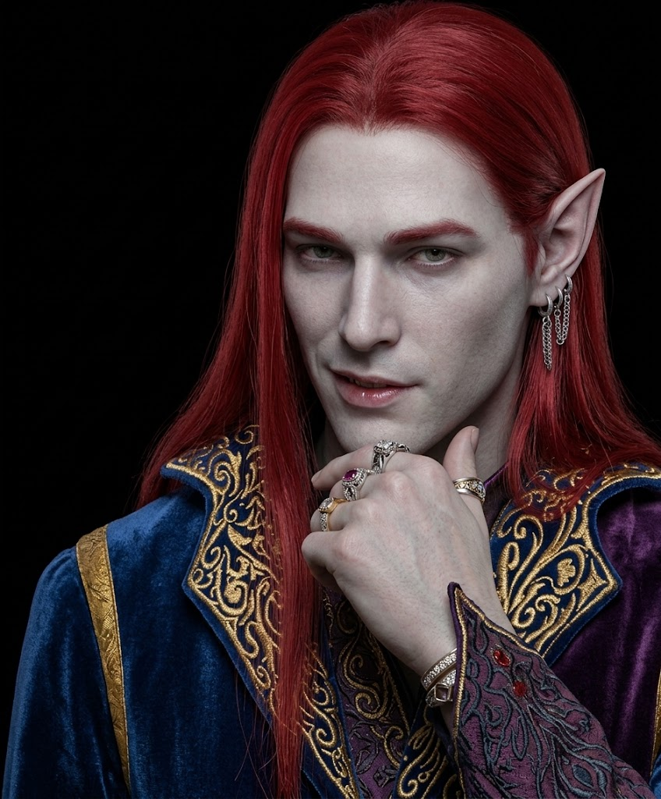

---
type:
 - "[[Ancestry]]"
source: La Notte Eterna
---

## Essenza e Archetipo
- **Descrizione Visiva**: figure snelle e affusolate, con pelle diafana che sembra assorbire la luce invece di rifletterla. I loro occhi sono completamente neri, i capelli corvini e/o rosso scuro a seconda dei casi, mentre la pelle è pallida. Leggermente più bassi e snelli dei comuni umani, sono di conseguenza piuttosto agili.
- **Origine**: Creature plasmate dalle correnti della Dimensione dello Spirito e della Materia. Sono nate quando il confine tra i mondi si è assottigliato durante i cataclismi che hanno preceduto e accompagnato la Guerra Celeste, rendendoli entità intrinsecamente legate all'equilibrio tra i piani.
- **Archetipo**: Esploratori del Velo e Guide. Si comportano come specialisti in mobilità e percezione, capaci di agire come "pilastri di silenzio" per il gruppo. Mentire è un'arte come un'altra nella loro cultura e sin da fanciulli sviluppano capacità che li rendono abili mercanti, in alcuni casi spie e sicari infallibili.

## Tratti Ancestrali (Meccaniche)
- **Sintonia con l'Ombra** *(prima feature)*: Quando ti trovi in una zona d'ombra, puoi marcare 1 *Stress* per ottenere vantaggio su un tiro d'azione di *Astuzia* o *Istinto*. Una volta per scena.
- **Passo Transdimensionale** *(seconda feature)*: Una volta per scena puoi teletrasportarti in un punto visibile entro Vicina (*Close*).

## Integrazione in Nebvarasa
- **Visione del Velo**: I karevi vedono attraverso l'oscurità magica e percepiscono i flussi di energia necrotica vicino a sé. È un tratto fisico: il Master lo usa come informazione narrativa, non come bonus automatico.
- **Percezione del Buio**: La Notte Eterna è il loro ambiente naturale (vedi la Regola dell'Oscurità nel Campaign Frame).
- **Relazione con le Fazioni**: Sono rispettati (e temuti) dalle gilde magiche di Neir che li usano come guide attraverso i Portali. Spesso visti con sospetto dalle fazioni che temono l'influenza della [[Dimensione dello Spirito]].