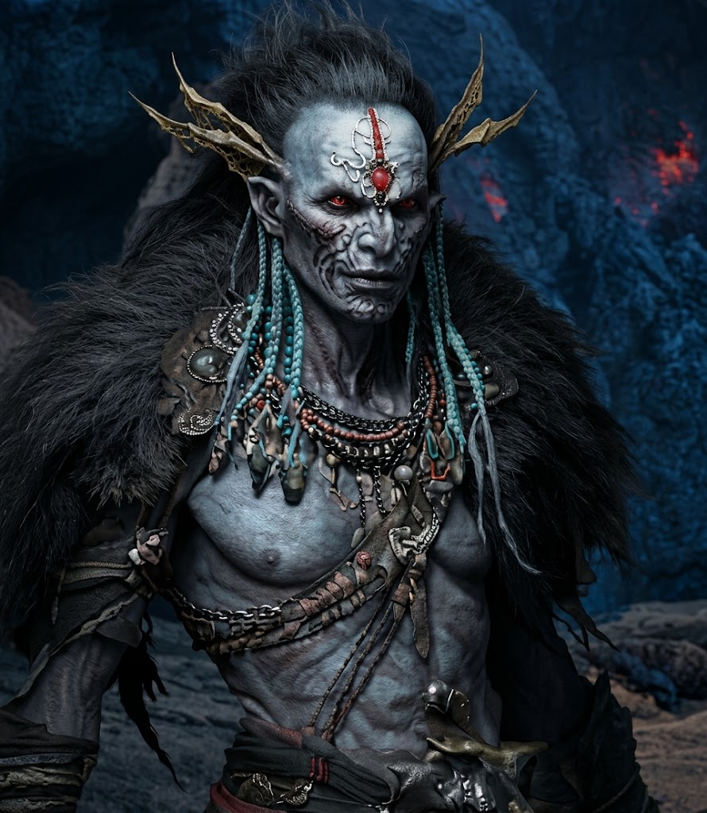

---
type:
 - "[[Ancestry]]"
source: La Notte Eterna
---

## Essenza e Archetipo
- **Descrizione Visiva**: Un tempo elfi, dopo aver conquistato il Principato di Valle Nuvolosa i klorss caddero sotto l'influenza della malvagia Principessa Demone, Izàfer. Tra le montagne fondarono un dominio tirannico, macchiandosi di crimini ed efferatezze ai danni dei nani e causando una profonda e insanabile spaccatura nel Reame di Dor. L'influenza di Izàfer ne contaminò perfino il retaggio fatato, trasformandoli in elfi delle profondità alterandone la natura. Sconfitti da un esercito di nani ed elfi unito contro il malvagio dominio di Izàfer, i klorss trovarono rifugio nelle caverne a nord delle Terre Nascoste, dove hanno abbandonato le vie oscure per dare origine a una società in armonia con il nuovo ambiente in cui si sono stabiliti, formando tredici tribù distinte, ognuna delle quali ha caratteristiche uniche che saranno meglio descritte nel Tomo delle Terre Nascoste. Con l'avvento della Notte Eterna è divenuto più facile incontrare viandanti klorss sulla terra di superficie, sebbene in quantità di gran lunga inferiore rispetto ai karevi. I klorss hanno la pelle grigio cenere e folti capelli scuri striati da ciocche dorate, mentre i penetranti occhi viola riflettono la loro eredità abissale. Hanno una corporatura snella e agile, eccellendo spesso come abili cacciatori.
- **Origine**: Discendenti delle antiche stirpi elfiche che hanno scelto di abitare gli abissi tra la Dimensione della Materia e la Dimensione dello Spirito, mutando nel tempo per sopravvivere al contatto con il Vuoto.
- **Archetipo**: Incantatori dell'Oscurità e Mediatori. Specializzati nel manipolare le energie necrotiche e nel percepire minacce che provengono da altri piani.

## Tratti Ancestrali (Meccaniche)
- **Sintonia Ectoplasmica** *(prima feature)*: Quando subisci danni magici (necrotici inclusi), puoi marcare 2 *Stress* per dimezzare il danno ricevuto.
- **Tocco del Velo** *(seconda feature)*: Spendi 1 *Speranza*: un avversario entro Vicina (*Close*) marca 1 *Stress* e ha svantaggio al suo prossimo attacco.

## Integrazione in Nebvarasa
- **Vista del Vuoto**: Gli occhi viola dei klorss non sono ingannati dall'oscurità e distinguono i contorni delle entità invisibili vicine. È un tratto fisico: il Master lo usa come informazione narrativa. *Versione meccanica opzionale:* vantaggio ai tiri di *Istinto* per individuare creature Nascoste o invisibili entro Vicina.
- **Percezione del Buio**: I klorss sono creature del crepuscolo perenne; la loro vista si è adattata a percepire le variazioni di temperatura e di energia anche dove non esiste alcuna fonte luminosa (vedi la Regola dell'Oscurità nel Campaign Frame).
- **Relazione con le Fazioni**: Visti con rispetto misto a terrore dalle gerarchie ecclesiastiche di Neir, che li considerano "toccati dal Vuoto". Sono invece consultati come oracoli dalle fazioni che operano ai margini dei portali dimensionali.