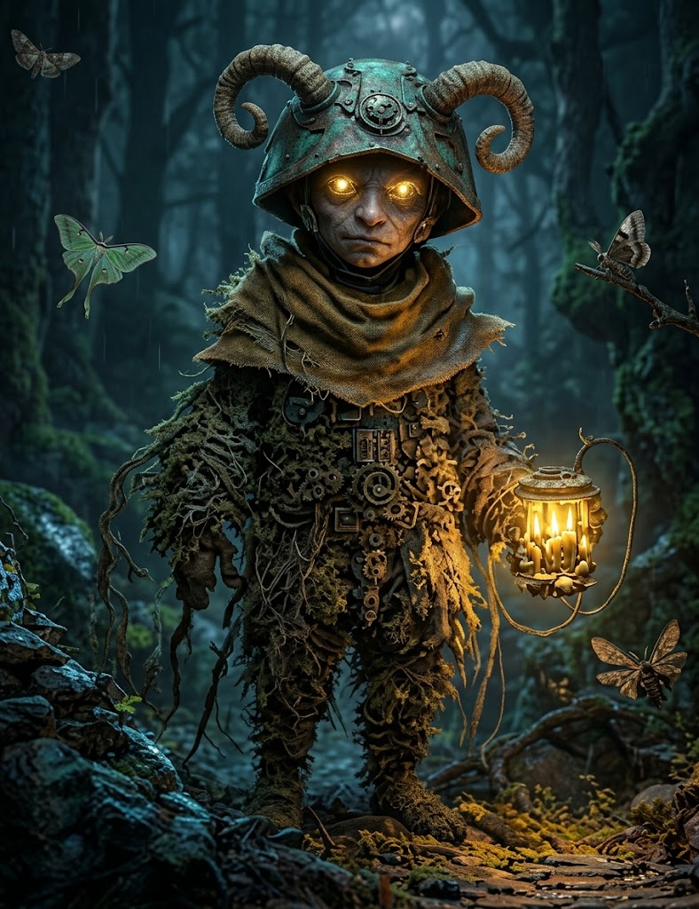

---
type:
 - "[[Ancestry]]"
source: La Notte Eterna
---

## Profilo
- **Descrizione Visiva**: Con l'avvento della Notte Eterna molte razze umanoidi hanno dovuto trasformare le proprie abitudini, in alcuni casi radicalmente, per sopravvivere a un mondo profondamente alterato. Tra chi ha saputo adattarsi al buio perenne ci sono i nuno, tribù gnomica originaria delle giungle che un tempo coprivano la Cenere di Lanie. Prima dell'impatto della meteora, lo sciamano alla guida dei nuno li guidò a nord verso la Verde Foresta, dove gli gnomi trovarono una forte resistenza da parte dei lucertoloidi, dei coboldi e delle altre razze che nel luogo fatato avevano cercato rifugio. Contro la forza e l'astuzia dei loro nemici, i nuno opposero l'antica arte di allevare e manipolare sciami di insetti volanti e striscianti, che non esitarono a scagliare contro i propri nemici riuscendo così a ritagliarsi un piccolo territorio. Negli anni successivi, piccoli gruppi di nuno si sono allontanati dalla Verde Foresta stabilendosi in altre selve di Neir, qualcuno spingendosi anche nelle Terre Nascoste. I nuno hanno una gerarchia ferrea al cui vertice siede lo sciamano della tribù supportato da una stretta cerchia di accoliti chiamati a curare gli allevamenti di insetti, principale arma di difesa e attacco dei nuno, nonché fonte di cibo privilegiata. Il rapporto dei nuno con gli insetti è ambivalente: danno in pasto agli insetti (o alle piante di cui si nutrono) carcasse animali e umanoidi, anche dei loro morti. Capelli e barbe dei nuno sono coperti interamente da sciami di insetti e in generale non c'è momento della loro vita in cui i nuno non sono accompagnati dai loro inseparabili alleati. Il rapporto che hanno con gli insetti li ha resi simili a loro nell'aspetto e nel comportamento: un nuno si comporterà in tutto e per tutto come un insetto nella difesa del suo villaggio-alveare, che i nuno costruiscono sempre in cima agli alberi più alti, calandosi in basso in sella a ragni, vespe e millepiedi giganti.
- **Origine**: Gnomi delle antiche giungle che coprivano la Cenere di Lanie, migrati a nord verso la Verde Foresta prima dell'impatto della meteora. Il loro rapporto simbiotico con gli sciami di insetti è insieme arma, cibo e cultura.
- **Archetipo**: Allevatori di sciami e sentinelle delle canopie. Esploratori di ambienti fitti, oscuri e claustrofobici.

## Tratti Ancestrali (Meccaniche)
- **Sciame Pungente** *(prima feature)*: Quando metti a segno un attacco con arma entro Vicina (*Close*), puoi spendere 1 *Speranza*: il tuo sciame infligge 1d6 danni fisici extra al bersaglio.
- **Sensi dell'Alveare** *(seconda feature)*: Spendi 1 *Speranza* e chiedi al Master cosa percepiscono i tuoi insetti entro Lontana (*Far*): presenza e posizione approssimativa di creature, passaggi, vibrazioni nel terreno. Il prossimo tiro d'azione che sfrutta quell'informazione ha vantaggio.

## Integrazione in Nebvarasa
- **Percezione del Buio**: I nuno non considerano la Notte Eterna un ostacolo, ma una condizione necessaria per la loro esistenza: i loro sciami li guidano anche nelle nebbie (vedi la Regola dell'Oscurità nel Campaign Frame).
- **Relazione con le Fazioni**: Spesso ignorati dagli abitanti della superficie, sono diventati indispensabili per le gilde di esploratori che devono penetrare nei livelli più profondi di Mendulia's Rock per recuperare materiali antichi.