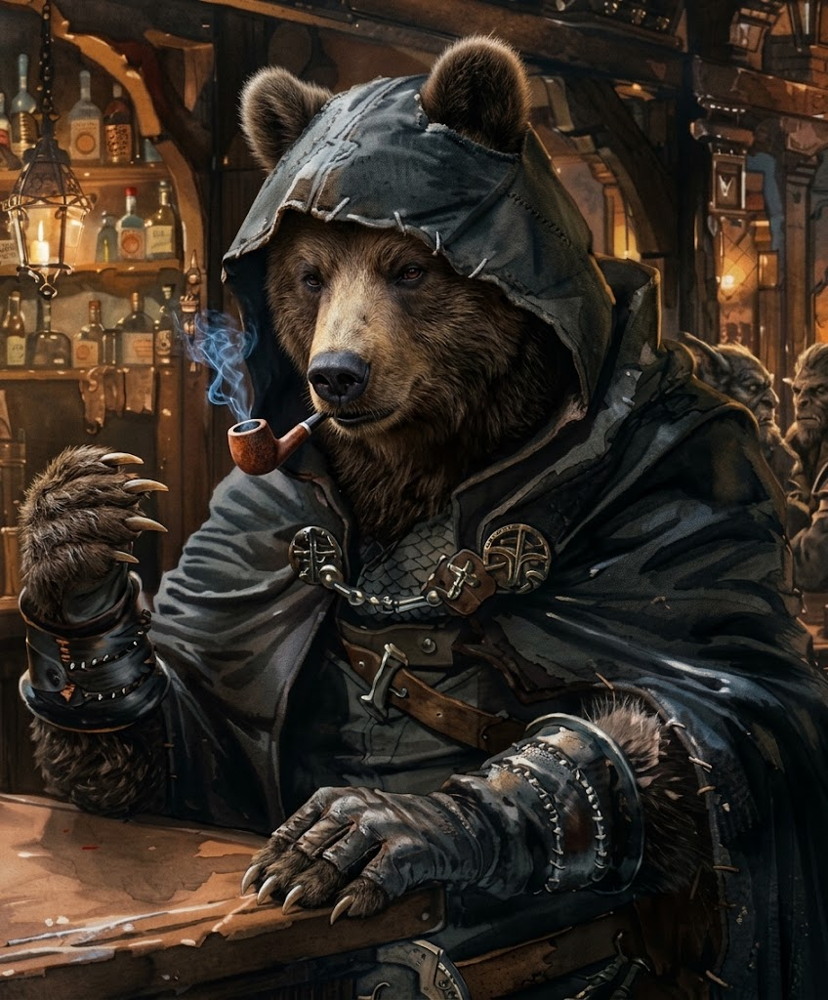

---
type:
 - "[[Ancestry]]"
source: La Notte Eterna
---

## Profilo
- **Descrizione Visiva**: Gli urakian abitano il brillante deserto conosciuto come [[Cenere di Lanie]]. È qui che le radiazioni magiche hanno trasformato i loro avi fondendone i corpi con gli animali. Il loro aspetto è quello di umanoidi con marcati tratti ferini. Sono un popolo nomade che vive di caccia e pastorizia. Di rado si avventurano fuori dal deserto e, all'inizio della loro avventura, ignorano sempre usi e costumi dei popoli civilizzati. La loro natura per metà animalesca li ha forniti di forza e capacità strabilianti, a scapito però di persecuzione e pregiudizi nelle terre cosiddette civilizzate. Giocare un avventuriero urakian non è semplice. Malvisti ovunque e spesso scambiati per una sottospecie di licantropi, difficilmente saranno accolti nella casa del connestabile o ingaggiati per una missione senza l'intermediazione del gruppo. L'uso del denaro e altre conoscenze basilari rappresentano un ulteriore ostacolo interpretativo, almeno ai primi livelli. La credenza che il sangue di urakian renda forti e sani coloro che lo ingeriscono è piuttosto diffusa nelle terre civilizzate e trae origine dalla predilezione che ne hanno i vampiri. Questi umanoidi presentano marcati tratti ferini e possiedono notevole forza e abilità derivanti dalla loro ascendenza animale.
- **Origine**: Discendenti di antichi nomadi del deserto della Cenere di Lanie, i cui corpi sono stati fusi con gli animali dalle radiazioni magiche. Pelle spessa e muscoli straordinari sono il loro retaggio.
- **Archetipo**: Difensori, combattenti da prima linea, distruttori.

## Tratti Ancestrali (Meccaniche)
- **Pelle Dura** *(prima feature)*: Ottieni un bonus permanente di +1 al *Punteggio di Armatura (Armor Score)* alla creazione del personaggio.
- **Furia Inarrestabile** *(seconda feature)*: Quando metti a segno un attacco in Mischia (*Melee*), puoi marcare 1 *Stress* per aggiungere 1d6 ai danni.

## Integrazione in Nebvarasa
- **Percezione del Buio**: Nessun trattamento speciale: per gli urakian valgono le regole comuni (vedi la Regola dell'Oscurità nel Campaign Frame).
- **Relazione con le Fazioni**: Reclutati come mercenari o guardie del corpo dalle gilde di [[Neir]]. Temuti dalle fazioni religiose, che li vedono come abominazioni.