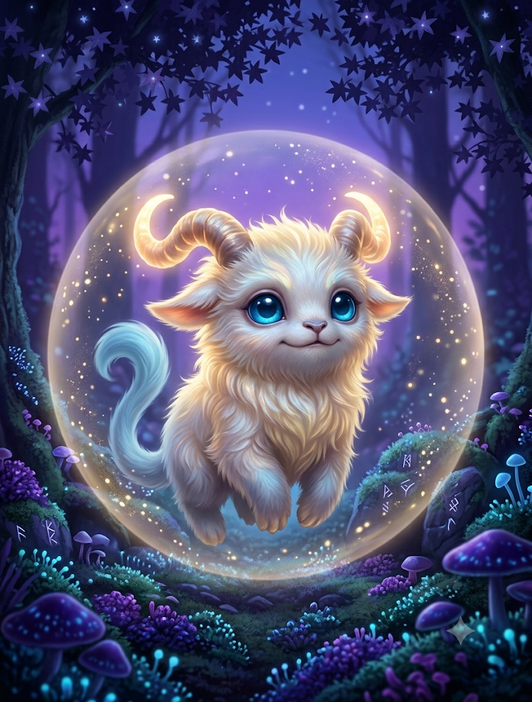

---
tags:
 - daggerheart/companion
 - companion/yamyam
 - wiloi
 - lore/azkabel
type: Companion
creature_type: Elementale Piccolo (Arcano)
owner_class: Qualsiasi sottoclasse con tratto di lancio
---

# 🐾 Yamyam (Compagno Wiloi)

Passeggiate tra le sale della [[Casa dei Musici e delle Belle Arti]] di [[Azkabel]], ammirando gli ologrammi che raffigurano le gesta dei più grandi incantatori *nüeth*, alcuni sopravvissuti alla distruzione della Città delle Sette Rune. Tra fuoco, fiamme e meraviglie arcane vi sembra di scorgere un particolare ricorrente. Vi avvicinate per guardare meglio, non c'è dubbio: quelle non sono ombre, ma **[[docs/06_Materiale_Notte_Eterna/Ancestry/Yamyam]]**, frammenti di anima materializzati in corpicini arruffati, immancabili famigli di ogni [[06_Materiale_Notte_Eterna/Ancestry/Wiloi]] che si rispetti. La storia è raccontata da uomini e donne di potere, ma a fare spesso la differenza anche nelle situazioni più disperate sono i loro servitori più fidati.

> *«Prendetevi cura di loro e avrete cura di voi stessi. Vi guarderanno le spalle in luoghi sconosciuti e lontani, saranno il vostro supporto in giorni bui e angosciosi.»*
> — **I Draghi di Yolamhra ai [[docs/06_Materiale_Notte_Eterna/Ancestry/Wiloi]] prima della partenza per [[Neir]]**

Gli yamyam sono estensioni dell'anima dei [[docs/06_Materiale_Notte_Eterna/Ancestry/Wiloi]]. Sono la feature *Anima Gemella* della loro ancestry e si comandano con il Tiro di Incantesimo. Non appena viene evocato, lo yamyam assume l'aspetto di una creatura che somiglia vagamente a un mammifero terrestre. Col tempo acquisisce varie abilità e assume un aspetto adorabile o spaventoso, a seconda dell'indole del possessore.

---

## 🔮 Creazione

1. **Nome e aspetto.** Dagli un nome e scegli come appare (un mammifero terrestre, vagamente).
2. **Evasione:** 10.
3. **Esperienze:** due, a +2 ciascuna (es. *Sussurri Arcani*, *Sempre all'Erta*, *Fedele fino alla Fine*). Ogni volta che ottieni una nuova Esperienza, anche lo yamyam ne ottiene una a +2.
4. **Attacco:** *Proiettile Arcano*, danni magici, dado d6, portata Vicina (*Close*).
5. **Aspetto:** scegli Purezza, Protezione o Furia. Riflette l'indole del possessore, non è un allineamento morale.
6. **Stress:** 3 caselle (valore provvisorio, da allineare alla scheda del Compagno ufficiale).

---

## 🪽 Forme

* **Forma Limitata (sempre disponibile):** spendi **1 Speranza** con un'azione per evocarlo. Può solo interagire con oggetti e ambiente, esplorare e comunicare con te in telepatia entro Lontana (*Far*). Non ha accesso ad attacco, Aspetto e crescita. Puoi congedarlo a costo zero e rievocarlo dopo un riposo (breve o lungo).
* **Vera Forma (una volta per riposo lungo):** con un'azione, per la durata di una scena, lo yamyam ha accesso a tutte le feature di questa scheda.

---

## 🎲 Comandarlo

* Per fargli compiere un'azione fai un **Tiro di Incantesimo**. Spendi 1 *Speranza* per aggiungere una sua Esperienza al tiro.
* Se hai successo con Speranza e la tua azione successiva si basa sul suo successo, ottieni vantaggio.
* Quando lo comandi ad attaccare, beneficia di ciò che normalmente vale solo per te. Il danno usa il tuo Proficiency e il suo dado.

---

## 💔 Danni e Legame d'Anima

* Qualsiasi danno subito dallo yamyam gli fa marcare 1 *Stress*. Quando marca l'ultimo esce dalla scena e torna al prossimo riposo lungo con 1 *Stress* cancellato.
* **Legame d'Anima:** quando esce dalla scena, tu marchi 1 *Stress*.
* Quando una mossa di riposo cancella *Stress* su di te, ne cancella altrettanto a lui.

---

## 🌟 Aspetti (scegline uno)

| Aspetto | Feature | Effetto |
| :--- | :--- | :--- |
| 🪽 **Purezza** | *Tocco Curativo* | Spendi 2 *Speranze*: una creatura toccata cancella 1 Punto Ferita o 2 *Stress*. |
| 🛡️ **Protezione** | *Scudo Arcano* | Una volta per scena, quando un alleato entro Vicina sta per marcare Punti Ferita, spendi 1 *Speranza*: ne marca 1 in meno. |
| 🗡️ **Furia** | *Tocco Mortale* | Quando il *Proiettile Arcano* va a segno, spendi 1 *Speranza* per aggiungere 1d8 danni necrotici. |

---

## 📈 Crescita

A ogni aumento di livello del possessore scegli un'opzione per lo yamyam:

* **Intelligente:** +1 a un'Esperienza dello yamyam.
* **Luce nel Buio:** una casella di Speranza aggiuntiva per te.
* **Conforto:** una volta per riposo, in un momento di quiete, ottieni 1 Speranza oppure voi due cancellate 1 *Stress*.
* **Corazzato:** quando subisce danni puoi marcare una tua casella di Armatura al posto del suo *Stress*.
* **Feroce:** dado di danno o portata +1 passo (d6→d8, Vicina→Lontana).
* **Resistente:** una casella di *Stress* in più.
* **Legato:** quando marchi l'ultimo Punto Ferita, lo yamyam accorre: tira un d6 per ogni sua casella di *Stress* non marcata e le marca; con almeno un 6 ti aiuta a rialzarti e cancelli quell'ultimo Punto Ferita.
* **Consapevole:** +2 all'Evasione.
* **Una sola per Aspetto** (dal tuo Aspetto):
  * 🪽 *Purezza:* **Preghiera Gentile**: una volta per riposo lungo gli alleati entro Vicina cancellano 1 *Stress*.
  * 🛡️ *Protezione:* **Barriera Arcana**: una volta per riposo lungo, spendi 2 *Speranze*: tu e fino a tre alleati entro Vicina avete +1 all'Evasione fino a fine scena.
  * 🗡️ *Furia:* **Mietitore Arcano**: quando usi *Tocco Mortale* puoi marcare 1 *Stress* per colpire anche una seconda creatura entro portata con lo stesso tiro.

---

## 🌱 Evoluzione dell'aspetto (narrativa)

* **Dal Tier 2 (livello 2):** le fattezze cambiano in base all'Aspetto.
  * 🪽 *Purezza:* piumaggio o pelliccia bianca, occhi che diventano due sfere celesti o dorate.
  * 🛡️ *Protezione:* occhi vispi, fattezze che ricordano un furetto.
  * 🗡️ *Furia:* aspetto di istrice mostruoso, occhi come tizzoni ardenti e famelici.
* **Dal Tier 3 (livello 5):** forma finale, taglia Media. La Purezza ricorda un celestiale dalle fattezze animali, la Protezione una creatura fatata, la Furia un immondo dalle fattezze animali. Nessun effetto meccanico aggiuntivo.