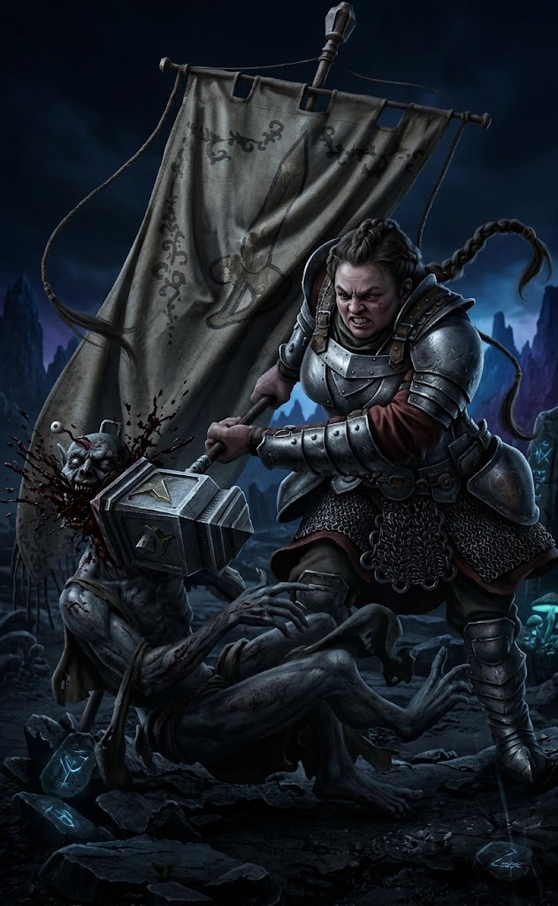

# Sottoclasse: Cavaliere Pesante

Resistenti combattenti e baluardi inamovibili specializzati nella pura forza fisica, nell'uso di pesanti armature e nel blocco implacabile delle cariche nemiche.

---

### Fondazione
**_Armatura del Veterano:_** La tua familiarità con le corazze pesanti le rende un'estensione del tuo corpo.
* Ignori qualsiasi penalità al tuo punteggio di **Evasione (Evasion)** derivante dall'indossare armature pesanti.
* Una volta per scena, mentre indossi armatura pesante, puoi marcare 1 *Stress* per ridurre di una soglia i danni fisici subiti.
---
### Specializzazione
**_Resilienza del Veterano:_** Puoi spendere **1 Speranza** per focalizzare l'attenzione e la guardia su un singolo avversario in vista. Fino a fine scena, quando ti infligge danno fisico, puoi marcare 1 Stress per ridurne la gravità di una soglia.
**_Nella Polvere:_** Quando riesci a bloccare o a colpire un bersaglio a portata **Mischia** con un tiro d'attacco in risposta a un suo movimento o azione, il nemico diviene temporaneamente **vulnerabile**.

---

### Maestria
**_Inamovibile:_** Sei un baluardo inscalfibile sul campo di battaglia:
* **+2 a entrambe le soglie** di danno.
* Una volta per scena, quando un effetto ti sposterebbe forzatamente o ti imporrebbe **Trattenuto**, puoi marcare 1 *Stress* per impedirlo.
---

## Domande di Sfondo

Rispondi a una qualsiasi delle seguenti domande di background. Puoi anche creare le tue domande.

- In quale celebre scontro dell'Armata dell'Apocalisse hai combattuto per meritare l'accesso alla Sala dei Gran Maestri?
- Di quale metallo o lega d'argento è fatta la tua corazza pesante, e quale fabbro di Öuin l'ha forgiata?
- Quale crimine o fallimento militare ti tormenta e ti spinge a cercare il martirio?

---

## Connessioni

Chiedi ai tuoi compagni di gioco una delle seguenti domande affinché il loro personaggio risponda, oppure crea le tue domande.

- Quale ferita d'arma da taglio ti ho inflitto o medicato durante il nostro primo incontro?
- Perché trovi che la mia spietatezza in battaglia sia necessaria per la sopravvivenza del gruppo?
- Quale promessa marziale ci lega nel fango delle trincee?
