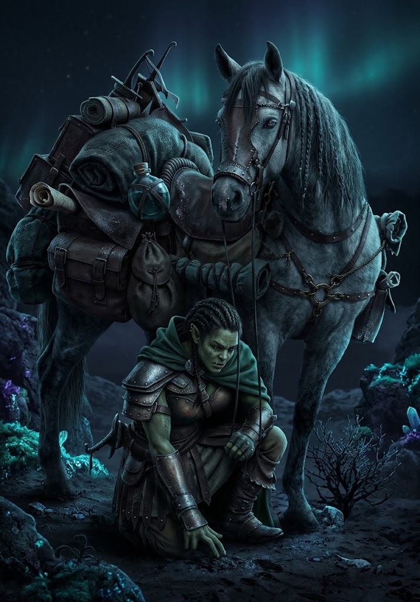

))
# Sottoclasse: Cavaliere dei Passi

Esploratori e ranger fondati da [[Edeber l'Esploratore]], in grado di muoversi in silenzio e superare barriere territoriali impossibili.

---

### Fondazione
**_Passo Lungo & Felpato:_** la tua andatura è rapida e quasi impalpabile.

* Ottieni permanentemente un **bonus di +1 al tuo punteggio di Evasione (Evasion)**
* Quando ti muovi, puoi coprire una distanza maggiore (ad esempio passare da una portata *Molto Vicina* a *Lontana*) con un singolo movimento narrativo.
* Ottieni **Vantaggio** a tutti i tiri di *Agilità* o *Furtività* effettuati mentre ti sposti o cerchi di non far sentire la tua presenza.

---

### Specializzazione
**_Passo Schivo:_** Hai +1 ad evasione. Sei maestro nel disimpegnarti dal pericolo. Quando ti allontani da un nemico a portata **Mischia (Melee)**, i nemici che cercano di intercettarti o reagire al tuo movimento subiscono **Svantaggio** al loro tiro d'attacco.
**_Passo Fuorviante:_** puoi spendere **1 Speranza** e descrivere un finto movimento o un'illusione ottica per confondere un avversario a portata visibile. Quell'avversario subisce **Svantaggio** a tutti i tiri d'attacco diretti contro di te finché non ti infligge danni o finché la scena non termina.

---

### Maestria
**_Passo Perfetto:_** Hai raggiunto il totale controllo del tuo peso e dell'equilibrio:

* Puoi camminare e correre su **superfici acquatiche e pareti verticali** come se fossero normale terreno pianeggiante.
* Ignori qualsiasi intralcio provocato da terreni perigliosi, ostacoli o vegetazione intricata.
* Ottieni **Resistenza** ai danni ambientali e alle trappole legate al terreno (come acido, fuoco di superficie, spintoni o trappole a pressione).

---
## Domande di Sfondo

Rispondi a una qualsiasi delle seguenti domande di background. Puoi anche creare le tue domande.

- Chi ti ha donato la cappa impermeabile e insegnato a camminare senza produrre alcun suono?
- Quale mappa delle fogne della Sezione LVI sei riuscito a rubare e cosa speri di trovarvi?
- Perché preferisci la solitaria e gelida notte all'addiaccio alla sicurezza di una locanda?

---

## Connessioni

Chiedi ai tuoi compagni di gioco una delle seguenti domande affinché il loro personaggio risponda, oppure crea le tue domande.

- Quale traccia o impronta hai lasciato che mi ha permesso di rintracciarti quando eri disperso?
- Perché la mia andatura silenziosa ti spaventa o ti rende vigile?
- Quale segreto dei territori boschivi della Landa di Edeber abbiamo scoperto insieme?
