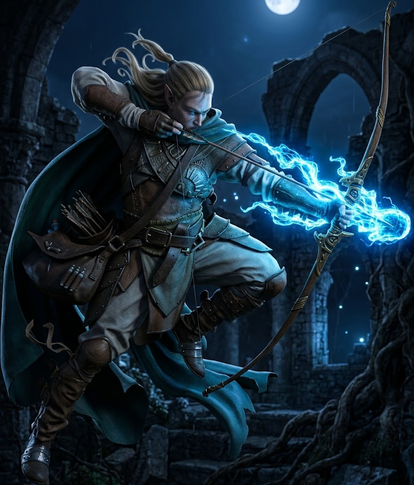

---
type:
  - Sottoclasse
classe:
  - "[[Wizard]]"
spellcast_trait:
  - Conoscenza (Knowledge)
Dominio:
  - "[[Codice]]"
  - "[[Lama]]"
  - "[[Ossa]]"
  - "[[Splendore]]"
source: La Notte Eterna
location:
  - "[[Mubunash]]"
  - "[[Ducato di Öuin]]"
  - "[[Vetta delle Anime]]"
---

# Sottoclasse: Cavaliere di Kurash

Maghi spadaccini e studiosi del Fuoco Segreto, in grado di unire la scherma all'energia arcana e di manipolare il tempo e la trama della realtà.

---

### Fondazione
**_Arcano della Lama:_** Puoi compiere un breve rito concentrato per manifestare una spada di pura energia arcana nella tua mano.
* Quando effettui un Tiro d'Attacco con quest'arma, usi il tuo tratto di lancio degli incantesimi (**Conoscenza**) invece della Forza.
* L'arma infligge **1d8 danni magici**.
* Puoi farla scomparire o richiamarla istantaneamente a te in qualsiasi momento del tuo movimento.

---

### Specializzazione
**_Arcano della Preveggenza:_** La tua visione anticipata degli eventi ti rende schivo e infallibile nelle prime fasi dello scontro.
* Finché non indossi un'armatura pesante, la tua **Evasione (Evasion)** aumenta permanentemente di **+1**.
* Quando la scena di combattimento ha inizio, puoi spendere **1 Speranza** per agire prima di chiunque altro, imponendo la tua iniziativa nel flusso narrativo.
**_Arcano del Tempo:_** Imparando a riavvolgere brevi istanti di tempo:
* Una volta per riposo lungo, quando tu o un alleato entro portata **Vicina (Close)** subite un attacco devastante o fallite un tiro decisivo, puoi marcare **1 Stress** e usare **1 Speranza** per annullare l'esito negativo appena avvenuto, costringendo il tiro a essere effettuato nuovamente o annullando l'azione del nemico.

---

### Maestria
**_Maestro del Fuoco Segreto:_** La tua lama arcana trascende le barriere della materia (hai +1 Proficinecy per gli attacchi della lama).

---

## Domande di Sfondo

Rispondi a una qualsiasi delle seguenti domande di background. Puoi anche creare le tue domande.

- Chi ti ha iniziato allo studio del Trattato sulla Scherma Arcana di Kurash?
- Quale segreto del Fuoco Segreto hai scoperto nelle rovine che ti fa temere l'interesse delle altre sette?
- Quale pegaso o destriero leggendario desideri evocare con l'Arcano dell'Alleanza?

---

## Connessioni

Chiedi ai tuoi compagni di gioco una delle seguenti domande affinché il loro personaggio risponda, oppure crea le tue domande.

- Quale mio incantesimo o trucco magico hai cercato di replicare con la tua spada?
- Perché ritieni che il mio pragmatismo sia fondamentale per compensare le tue manie di grandezza accademica?
- Quale aneddoto sul leggendario spadaccino Kurash mi tormenti a raccontare ogni notte?
