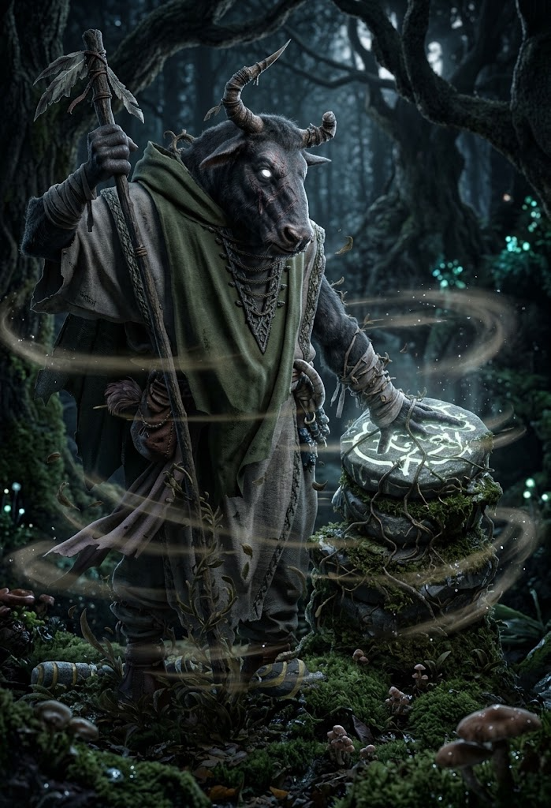

# Sottoclasse: Custode dei Segreti

Druidi del Circolo dei Segreti, protettori della fonte primigenia del Fuoco Segreto, vincolati al silenzio eterno.

---

### Fondazione
**_Segreto del Fuoco:_** Una volta per scena, quando utilizzi la tua capacità di _Forma Selvatica (Beastform)_ o trasformazione naturale, puoi scegliere di recuperare immediatamente **2 punti Stress** o **1 Speranza**.

---

### Specializzazione
**_Invocare il Fuoco:_** Quando lanci una capacità magica di danno o cura, puoi spendere **1 Speranza** per potenziarla con l'energia del Fuoco Segreto. Puoi scegliere uno dei seguenti effetti:
- Infliggi **+1d8 danni magici da Fuoco** extra.
- Permetti al bersaglio di cancellare **1 Punto Ferita** o **1d4 Stress** marcati in più.

---

### Maestria
**_Tutt'uno con la Fiamma:_** _**:**_ Una volta per riposo lungo, quando tu o un alleato a portata **Vicina (Close)** fallite un Tiro di Reazione o subite gli effetti di una magia o trappola nemica, puoi spendere **2 Speranze** per annullare completamente l'effetto magico su di voi.

---

## Domande di Sfondo

Rispondi a una qualsiasi delle seguenti domande di background. Puoi anche creare le tue domande.

- Quale rito d'iniziazione hai dovuto superare per conoscere l'esistenza del Fuoco Segreto?
- Perché non puoi parlare di ciò che avviene nel Circolo dei Segreti, pena la perdita permanente della parola (Rovina ai Traditori)?
- Quale scettro della foresta ti ha affidato l'Arcidruido [[Fahrn]] prima della sua morte?

---

## Connessioni

Chiedi ai tuoi compagni di gioco una delle seguenti domande affinché il loro personaggio risponda, oppure crea le tue domande.

- Quale segreto sulla natura ti ho confidato che ti fa temere che io possa rivelarlo?
- Perché ti senti più protetto quando combatto al tuo fianco?
- Quale mia azione ha quasi violato il giuramento del silenzio del tuo Circolo?
