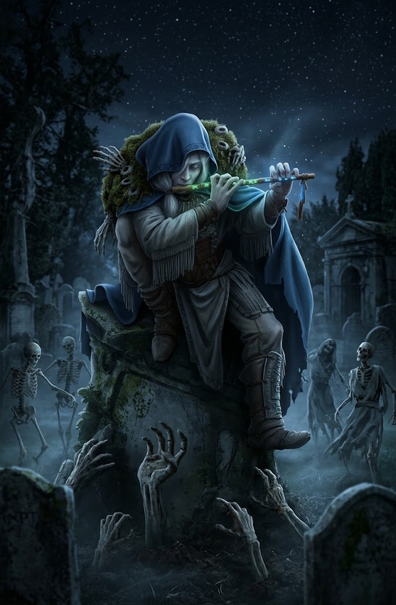

# Sottoclasse: Danse Macabre

La musica proibita non è scritta su nessun spartito accademico, ma viene sussurrata e tramandata per via orale all'interno della setta eretica di [[Krea]], la Dama Nera. Chi intraprende questo cammino non cerca il mero intrattenimento dei vivi, ma la risonanza profonda dell'oltretomba. Danzando sulle lapidi dei cimiteri e pizzicando corde dissonanti, il Danse Macabre canalizza le energie ematiche e spirituali della morte, terrorizzando i vivi e costringendo i morti a rialzarsi per ballare al ritmo spettrale delle sue melodie.

---

### Fondazione
**_Melodia dell'Oltretomba:_** Ottieni **Vantaggio** a tutte le prove di _Presenza_ o _Spettacolo_ effettuate per interagire con spiriti, defunti o non morti. Inoltre, quando lanci un incantesimo del dominio del **Terrore**, puoi spendere **1 Speranza** per costringere un nemico entro portata **Vicina (Close)** a subire 1 Stress e avendo svantaggio al prossimo attacco.

---

### Specializzazione
**_Danza degli Spettri:_** Quando ti sposti, puoi marcare **1 Stress** per svanire parzialmente nel velo dell'oltretomba. Fino alla tua prossima azione ottieni **+2 all'Evasione (Evasion)** e puoi attraversare nemici e ostacoli solidi. Qualsiasi nemico oltrepassato subisce **1d6 danni da Freddo**.

**_Sinfonia della Dama Nera:_** Una volta per scena, puoi spendere **2 Speranze** per intonare un accordo spettrale. Tutti i servitori non morti sotto il tuo controllo entro portata **Lontana (Far)** ottengono **+2 all'Armatura** e infliggono **+1d6 danni Necrotici extra** ai loro attacchi finché dura la scena.

**_Canto della Carne Morta:_** Quando una creatura muore entro portata **Lontana (Far)** da te, puoi marcare **1 Stress** per rianimarla all'istante come **Zombie Marionetta** (minion) per la durata della scena. Ne hai al massimo una. Non agisce da sola: quando attacchi aggiunge il suo danno fisso, oppure intercetta un attacco e si distrugge riducendo di 1 i PF marcati.

---

### Maestria
**_Alzati e Cammina:_** Quando metti a segno un **Successo Critico** con un attacco o un incantesimo, puoi spendere **3 Speranze** per consumare la forza vitale del bersaglio: un nemico sconfitto si rianima immediatamente come **Scheletro d'Élite** al tuo servizio (minion livello pari al tuo) (fino a un massimo di 2 attivi). Quando subisci danni, puoi distruggere uno dei tuoi scheletri per ridurre di 1 i Punti Ferita marcati.

---

### Domande di Sfondo
*Rispondi a una qualsiasi delle seguenti domande per definire il tuo passato, oppure creane una tua.*
- In quale antica catacomba o rovina di Gundazar hai ascoltato per la prima volta lo spartito proibito della Danza Macabra?
- Quale illustre accademico della Casa dei Musici di Azkabel ti ha denunciato alle autorità per aver tentato di suonare la melodia dei morti?
- Krea ha posato il suo sguardo scheletrico su di te durante una notte di luna calante. Quale patto o promessa le hai sussurrato per ottenere questo potere?

---

### Connessioni
*Scegli una connessione con un altro personaggio del gruppo.*
- Ti ho visto tremare quando ho suonato il mio primo accordo spettrale. Quale tuo caro defunto hai visto proiettato nella mia ombra?
- Durante il nostro viaggio nei bassifondi di Mendulia's Rock, la mia musica ti ha salvato la vita rianimando un ladro dei Dardi Sanguinanti. Cosa mi hai promesso in cambio di quel ballo proibito?
- Quale bizzarra melodia mondana condividiamo durante le lunghe pause attorno al fuoco?
