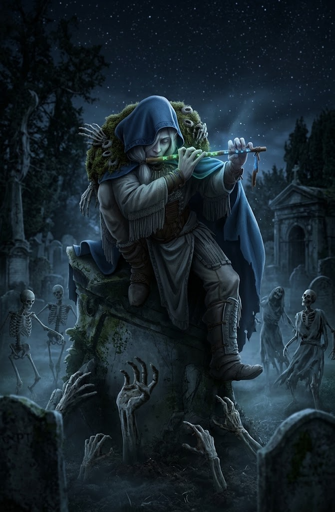

# Sottoclasse: Danse Macabre

La musica proibita non è scritta su nessun spartito accademico, ma viene sussurrata e tramandata per via orale all'interno della setta eretica di [[Krea]], la Dama Nera. Chi intraprende questo cammino non cerca il mero intrattenimento dei vivi, ma la risonanza profonda dell'oltretomba. Danzando sulle lapidi dei cimiteri e pizzicando corde dissonanti, il Danse Macabre canalizza le energie ematiche e spirituali della morte, terrorizzando i vivi e costringendo i morti a rialzarsi per ballare al ritmo spettrale delle sue melodie.

---

### Fondazione
**_Melodia dell'Oltretomba:_** Una volta per scena ottieni **Vantaggio** a una prova di *Presenza* per interagire con spiriti, defunti o non morti. Inoltre, quando usi una carta del dominio **Terrore** o **Grazia**, puoi spendere **1 Speranza**: un nemico entro **Vicina** marca 1 *Stress* e subisce **Svantaggio** al prossimo attacco.

---

### Specializzazione
**_Danza degli Spettri:_** Una volta per scena, quando ti sposti, puoi marcare **1 Stress**: fino alla tua prossima azione gli attacchi diretti contro di te hanno **Svantaggio**, puoi attraversare ostacoli narrativi senza restarvi bloccato e un nemico oltrepassato subisce **1d6** danni da freddo.

**_Sinfonia della Dama Nera:_** Una volta per scena puoi spendere **2 Speranze**: fino alla fine della scena, i servitori non morti sotto il tuo controllo entro **Lontana** ottengono **Vantaggio** al loro prossimo attacco oppure aggiungono **1d6** danni necrotici al loro prossimo colpo riuscito.

**_Canto della Carne Morta:_** Quando una creatura muore entro portata **Lontana** da te, puoi marcare **1 Stress** per rianimarla all'istante come **Zombie Marionetta** (minion) per la durata della scena. Ne hai al massimo una. Non agisce da sola: una volta per scena aggiunge 1d6 danni al tuo attacco oppure si distrugge per ridurre di uno i Punti Ferita che marchi.

---

### Maestria
**_Alzati e Cammina:_** Una volta per riposo lungo, dopo un **Successo con Speranza** che sconfigge un nemico, puoi spendere **3 Speranze**: si rialza come uno scheletro minion fino alla fine della scena. Puoi mantenerne attivi al massimo due; una volta per scena uno può distruggersi per ridurre di uno i Punti Ferita che segni.

---

### Domande di Sfondo
*Rispondi a una qualsiasi delle seguenti domande per definire il tuo passato, oppure creane una tua.*
- In quale antica catacomba o rovina di Gundazar hai ascoltato per la prima volta lo spartito proibito della Danza Macabra?
- Quale illustre accademico della Casa dei Musici di Azkabel ti ha denunciato alle autorità per aver tentato di suonare la melodia dei morti?
- Krea ha posato il suo sguardo scheletrico su di te durante una notte di luna calante. Quale patto o promessa le hai sussurrato per ottenere questo potere?

---

### Connessioni
*Scegli una connessione con un altro personaggio del gruppo.*
- Ti ho visto tremare quando ho suonato il mio primo accordo spettrale. Quale tuo caro defunto hai visto proiettato nella mia ombra?
- Durante il nostro viaggio nei bassifondi di Mendulia's Rock, la mia musica ti ha salvato la vita rianimando un ladro dei Dardi Sanguinanti. Cosa mi hai promesso in cambio di quel ballo proibito?
- Quale bizzarra melodia mondana condividiamo durante le lunghe pause attorno al fuoco?
